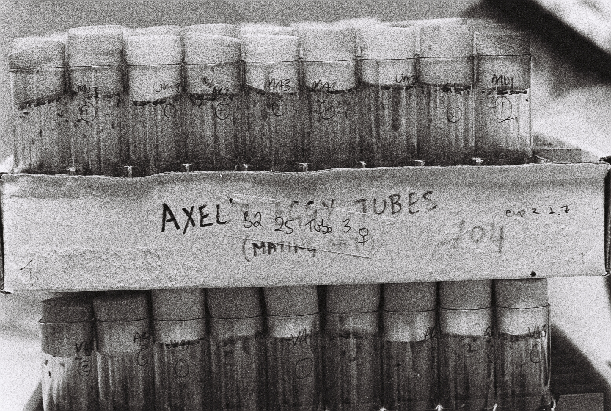

This year has been a bit of a rollercoaster for me. Lots rejections, some success in the lab, lots of self-doubt. I suppose these are all normal parts of the job as a scientist.

I have also inherited some ancient photography equipment from various sources and started playing around with taking pictures on film.

I suppose it's also normal for the personal life to blur into the professional. So here is one picture that I think turned out quite nice.

||  
|--|  

I like it for the juxtaposition of order (or perhaps the attempt at it), which is part and parcel of science, and disorder (or the perception of it) which is the often seemingly chaotic natural world. This juxtaposition is apparent at a few levels in the same picture.
